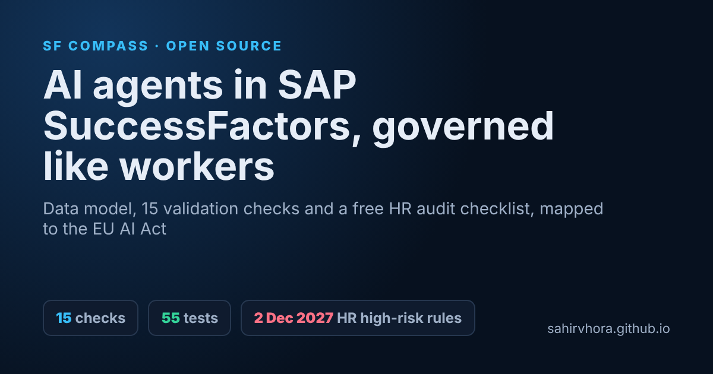

# SF Agent Workforce: AI agents in SAP SuccessFactors, governed like workers

[](https://github.com/SahirVhora/sf-agent-workforce/actions/workflows/ci.yml)
[](https://sahirvhora.github.io/sf-agent-workforce/)


**An open-source data model and validator for governing AI agents in SAP SuccessFactors Employee Central, with every check mapped to the EU AI Act.**

**Live site:** https://sahirvhora.github.io/sf-agent-workforce/ · **Free download:** [EU AI Act HR audit checklist (.xlsx)](https://sahirvhora.github.io/sf-agent-workforce/downloads/EU_AI_Act_HR_Audit_Checklist.xlsx)



AI agents already validate payroll, screen applications and answer employee queries. Almost nobody records them where work is planned, costed and governed. This repo gives HRIS teams and SuccessFactors consultants:

- **A data model** ([docs/DATA_MODEL.md](docs/DATA_MODEL.md)) for an effective-dated `cust_DigitalWorker` MDF object with accountable owner, kill-switch owner, cost centre, position, decision scopes, oversight mode and expiring permissions. Agents sit beside employees, never as employees.
- **An EU AI Act mapping** from decision scopes to Annex III point 4 (employment) and the Article 5(1)(f) prohibition on workplace emotion recognition, using the dates in Regulation (EU) 2026/1744.
- **A validator** running 15 CHK-AGT checks over an agent register export, with console, JSON and HTML output and a CI-friendly exit code. [See a sample report](https://sahirvhora.github.io/sf-agent-workforce/sample-report.html).
- **A 36-item EU AI Act HR audit checklist** covering deployer and provider obligations, with a triage of 12 common HR AI use cases.

## Why not create agents as employees?

Creating agents as Users with EmpJob records inflates headcount and statutory reporting, risks payroll replication to EC Payroll or third-party payroll, can consume per-employee licences and fills employment fields with junk. Model them as their own object that references the same positions, cost centres and people. Full reasoning in [DATA_MODEL.md](docs/DATA_MODEL.md).

## EU AI Act dates for HR (as amended)

| Date | What applies |
|---|---|
| 2 Feb 2025 | Prohibitions, including workplace emotion recognition (Art. 5) |
| 2 Aug 2026 | Transparency duties, such as disclosing AI interaction (Art. 50) |
| 2 Dec 2027 | Annex III high-risk obligations, including employment uses |

## Quick start

```bash
git clone https://github.com/SahirVhora/sf-agent-workforce
cd sf-agent-workforce
python -m agent_workforce.validate examples/demo_with_findings.json --as-of 2026-10-10 --html report.html
python -m pytest -q
```

No runtime dependencies. Python 3.10+. Tests need `pytest`. Exit codes: `0` clean, `1` errors found, `2` input unreadable.

## Input

One JSON file with `agents`, `employees` (userId, status), `positions` (code, status, staffingType) and `costCenters`. Schema: [schema/agent_register.schema.json](schema/agent_register.schema.json), generated from `agent_workforce/model.py` and tested for drift. Pull it from SuccessFactors via OData v2 on `cust_DigitalWorker`, `EmpEmployment`, `Position` and `FOCostCenter`.

## Check catalogue

15 checks, CHK-AGT-00 to CHK-AGT-14: accountable owner, kill switch, classification consistency, human oversight, log retention (Art. 26(6)), worker consultation (Art. 26(7)), permission expiry, position control, cost centre, review cadence, effective-dating integrity, oversight span and prohibited practices. Details and legal basis: [docs/CHECKS.md](docs/CHECKS.md).

## Layout

```
agent_workforce/  model.py (enums, thresholds)  checks.py (CHK-AGT-00..14)  validate.py (CLI)  schema.py
docs/             DATA_MODEL.md  CHECKS.md
downloads/        EU_AI_Act_HR_Audit_Checklist.xlsx
examples/         clean_register.json  demo_with_findings.json
schema/           agent_register.schema.json
templates/        field_mapping.csv (register field to MDF field and picklist)
tests/            55 tests: every check, boundary cases, schema and doc drift, site SEO and links
```

## Limits

This checks the register, not the law. A clean run is evidence of control, not a conformity assessment or legal advice. The 365-day permission cap and 10-agents-per-owner threshold are house defaults; tune them in `model.py`.

## Part of SF Compass

One of the open-source tools in the [SF Compass](https://sahirvhora.github.io/sf-compass/) SAP SuccessFactors transformation assurance suite by [Sahir Vhora](https://sahirvhora.github.io/). Related: [Position Integrity Checker](https://github.com/SahirVhora/sf-position-integrity-checker), [Pay Transparency](https://github.com/SahirVhora/sf-pay-transparency), [Config Compare](https://github.com/SahirVhora/sf-config-compare).
